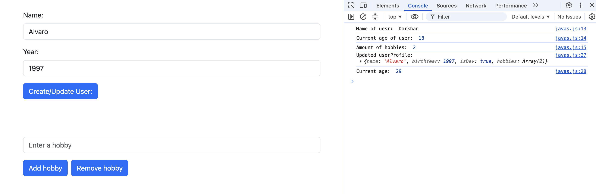
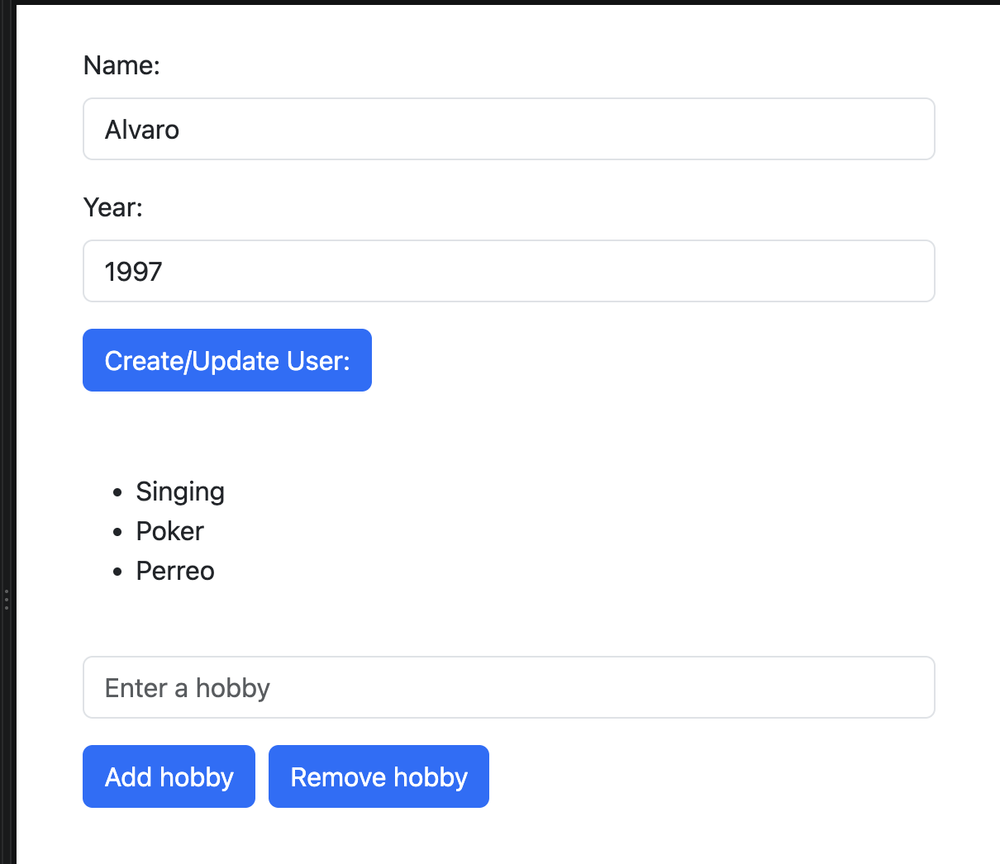
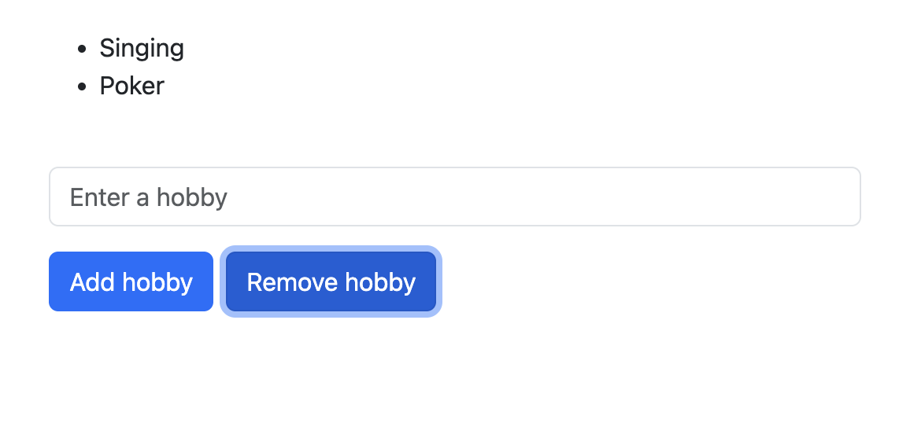

# Assignment 5

**Serikbai Darkhan**
**SE-2540**

## Theory 
I used variables to store data inside objects. Printed messages using `console.log`. Gave a script on buttons via `addEventListener` to manipulate html (adding/deleting `<li>`) and data changing `userProfile` object.

## Features
* **User Profile:** Updates `userProfile` objects on submit
* **Hobibes list:** Adds and removes `<li>` items dynamically

## Sreenshots

**Changing object**

**adding item to unordered list by clicking on `add hobby` button**

**deleting item by clicking on `remove hobby` button**

# perreo
